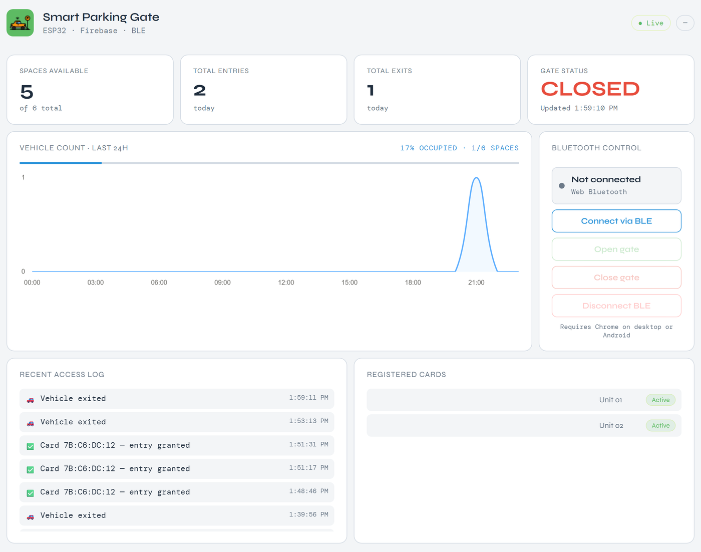

# Smart Parking Gate System

An ESP32 parking gate that lets in RFID cardholders, counts free spaces as cars enter and leave, and shows everything on a live web dashboard. Authorised users can also open or close the gates over Bluetooth.



## How it works

**Entry**
1. A driver taps an RFID card at the entry gate.
2. If the card is authorised, the entry servo raises the gate arm.
3. The entry ultrasonic sensor detects the car passing; once it has cleared, the gate closes. The gate is force-closed after 15 seconds if no car passes.
4. The free-space count goes down by one.

**Exit**
1. The exit ultrasonic sensor detects a car approaching, and the exit gate opens automatically.
2. Once the car has cleared, the gate closes and the free-space count goes up by one.

**Display and sync**
- A 16×2 LCD at the gate shows the number of free spaces and each event.
- The ESP32 pushes the current state to Firebase Realtime Database, and the dashboard updates live from it.

**Manual control:** from the dashboard (Chrome on desktop or Android), an operator can connect to the ESP32 over **Web Bluetooth** to open or close the gates, even without internet access.

## Design choices

- **Two FreeRTOS tasks on separate cores.** Gate control (RFID, sensors, servos, LCD, Bluetooth) runs on core 0 at higher priority. The Firebase sync runs on core 1. A slow or dropped connection never delays the gate.
- **Secrets stay out of the repo.** Wi-Fi and Firebase credentials go in `firmware/include/config.h`, which is git-ignored; `config.example.h` is the template.
- **Unit tests** for the gate logic (both gates start closed, and each opens and closes independently) and for RFID authorisation (accepted, rejected, lowercase UIDs and malformed UIDs). They run with PlatformIO's test runner.

## Hardware

ESP32 DevKit · MFRC522 RFID reader · 2 × servo gate arms · 2 × HC-SR04 ultrasonic sensors · 16×2 I²C LCD · buzzer

The wiring is in [`docs/pin_mapping.md`](docs/pin_mapping.md).

## Tech stack

| Part | Tools |
|---|---|
| Firmware | C++ (Arduino framework), FreeRTOS, PlatformIO; MFRC522, ESP32Servo, Firebase ESP Client and LiquidCrystal_I2C libraries |
| Cloud | Firebase Realtime Database (with security rules) and Firebase Hosting |
| Dashboard | JavaScript, Vite, Chart.js, Web Bluetooth API |

## Repository layout

```
firmware/    ESP32 code (src/, include/, test/) and platformio.ini
dashboard/   Vite web dashboard (Firebase, Chart.js, Web Bluetooth)
firebase/    Realtime Database security rules
docs/        Pin mapping and project slides
```

## Run it

**Firmware**
1. Copy `firmware/include/config.example.h` to `config.h` and fill in your Wi-Fi and Firebase details.
2. Open `firmware/` in PlatformIO, then build and upload to an ESP32 DevKit.
3. Run the tests with `pio test`.

**Dashboard**
1. `cd dashboard`, then `npm install`.
2. `npm run dev` for local development, or `npm run deploy` to build and publish to Firebase Hosting.

## Team and credits

This was a team project for Computer Architecture and Organization (Lab).

- **Jed B. Padro:** firmware (FreeRTOS tasks, RFID, gate, sensor, LCD and Bluetooth logic, unit tests, PlatformIO setup) and the web dashboard.
- **Teammates:** hardware build and assembly.

Portfolio: [jeedp.github.io/portfolio](https://jeedp.github.io/portfolio/)
